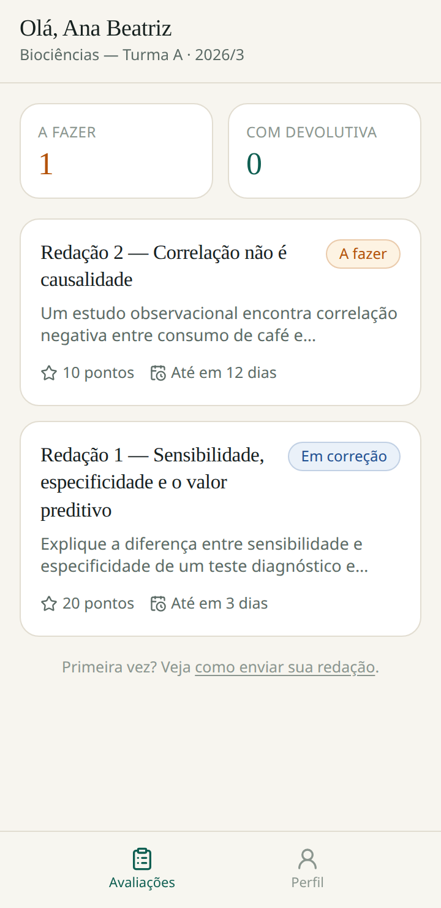
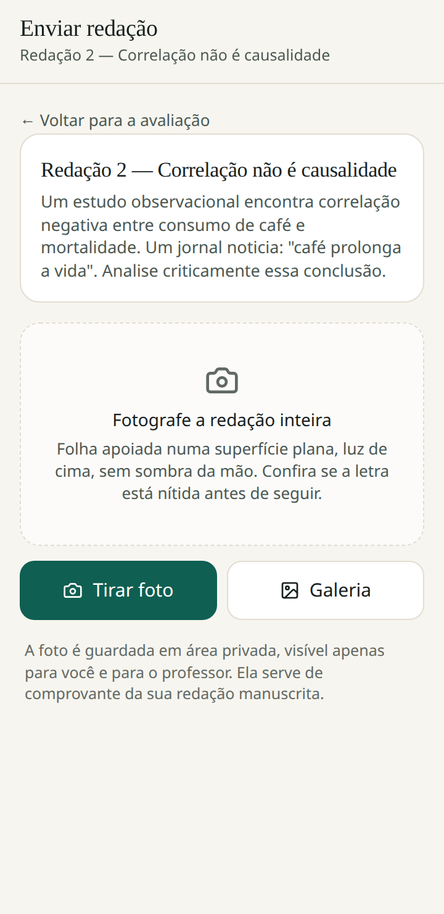
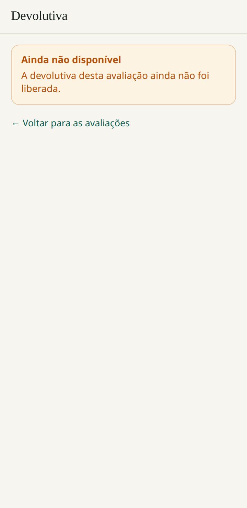

# Guia do aluno — enviar a redação

Este é o passo a passo do app **Avaliações — Análise de Dados para Biocientistas**
(<https://estatistica-biocientistas-avaliacao.vercel.app>). Ele funciona no celular, no navegador; não
precisa instalar nada.

O que você vai precisar: o celular, uma folha A4 com a redação **escrita à mão**, luz boa e o link do
app.

---

## 1. Primeiro acesso: criar a conta

Só entra quem está na lista da turma. Os três dados abaixo precisam ser **exatamente** os que a
coordenação tem:

| Campo | O que digitar |
|---|---|
| Turma | a sua turma (ex.: `CBV018GV-A · 2026/3`) |
| Nome completo | seu nome, como na lista |
| Matrícula | só os números e letras, como no SIGA (ex.: `202506007GV`) |
| E-mail institucional | o mesmo e-mail da lista da turma |
| Curso | ex.: Ciências Biológicas |
| Senha | pelo menos 8 caracteres — guarde ou use o gerenciador do celular |

Marque o aviso de privacidade e toque em **Criar conta**.

Se aparecer **“Esta matrícula não está na lista da turma”** ou **“Este e-mail é diferente do que
consta na lista”**, não tente adivinhar: peça ao professor para conferir a lista. É o erro mais comum
no primeiro dia, e ele acontece quando o e-mail digitado difere do e-mail que está na planilha da
turma.

## 2. Entrar

E-mail e senha. Se esqueceu a senha, use **Esqueci minha senha** na tela de entrada: chega um link no
e-mail (confira o spam). O link vale por uma hora.

Se o link expirar ou já tiver sido usado, o app **avisa** ao abrir: “Este link expirou… peça outro
abaixo” — e a tela já traz o campo para pedir um novo. Você não precisa adivinhar o que aconteceu.

Cada cartão é uma avaliação. O selo à direita diz em que pé você está:

| Selo | Significado |
|---|---|
| **A fazer** | ainda não enviou |
| **Em correção** | enviada; o professor ainda não liberou a devolutiva |
| **Com devolutiva** | nota e comentários disponíveis |
| **Devolvida para ajuste** | o professor pediu para reescrever (veja a seção 6) |

## 3. Enviar a redação

1. Toque na avaliação. Leia o **tema** e as **instruções** — eles dizem o que precisa aparecer no
   texto e quantas linhas escrever.
2. Toque em **Fotografar minha redação**.
3. Tire a foto da folha inteira, ou toque em **Galeria** para usar uma foto já tirada.
4. Confira a foto (dá para **Trocar foto**) e toque em **Usar esta foto**.
5. O app mostra o **texto que ele leu da sua foto**. Leia com atenção, corrija o que estiver errado e
   marque a caixa de confirmação. Toque em **Enviar redação**.

**Por que conferir o texto?** A correção é feita sobre o texto, não sobre a foto. Um erro de leitura
muda o sentido do que você escreveu: se o app leu “especialidade” onde estava “especificidade”, o
critério sobre especificidade será avaliado injustamente. Corrija o texto ali antes de enviar — é ele
que o professor avalia.

### Como tirar uma foto que o app consegue ler

| Faça | Evite |
|---|---|
| Folha apoiada numa mesa plana | Folha na mão, torta ou amassada |
| Luz de cima, de dia, sem sombra da mão | Sombra do corpo sobre a folha |
| A folha inteira dentro do quadro | Cortar a margem ou o fim do texto |
| Letra legível, caneta escura | Lápis claro, corretivo em excesso |

Não é preciso scanner nem PDF. A foto fica guardada em área privada e serve de comprovante da sua
redação manuscrita.

### Foto do iPhone (HEIC)

O iPhone, por padrão, salva as fotos em **HEIC** — um formato que o Chrome, o Firefox e o Android não
abrem. Se você escolher uma foto da galeria e o app disser que não conseguiu abrir, há dois caminhos:

| Caminho | Como |
|---|---|
| Mais simples | toque em **Tirar foto**: a câmera do navegador entrega a imagem em JPG, que abre em qualquer celular |
| Usar a galeria | no iPhone: **Ajustes → Câmera → Formatos → “Mais compatível”**; as fotos novas passam a ser JPG (as antigas continuam HEIC) |

A mensagem do app diz qual dos dois usar — ela não aparece para JPG, PNG ou WEBP.

## 4. Data de referência e recebimento

Cada avaliação pode ter uma **data de referência**, mostrada no cartão (“Referência: em 3 dias”). Ela
serve para dizer se a sua entrega está **fora do prazo** — não para fechar o envio. Uma avaliação com a
data no passado continua aceitando redação enquanto o professor estiver recebendo.

Quem controla isso é o professor: quando ele desmarca **Recebendo trabalhos**, o cartão passa a mostrar
**Entregas encerradas** e o botão de envio some. Se você ainda precisa entregar, peça a ele para
reabrir; quando ele marca de novo, o botão volta sozinho.

O app usa o horário de Brasília para decidir a marca de atraso. Entregar 23h59 do dia de referência
conta como no prazo; 00h01 do dia seguinte fica marcado como fora do prazo — mas o envio só é recusado
se o professor tiver encerrado o recebimento.

## 5. Ver a devolutiva

Quando o professor libera, o cartão ganha o selo **Com devolutiva**. Toque para ver:

- a **nota** (ex.: 17,6 de 20 — e o equivalente de 0 a 10);
- os **pontos fortes** do seu texto;
- os **pontos a desenvolver**, com o que fazer na próxima;
- a nota **critério por critério**, com o comentário de cada um.

A nota que vale é a que o professor lança no SIGA. O app mostra a mesma conta: `nota ÷ valor total × 10`.

## 6. Se a redação for devolvida para reescrever

O professor pode devolver a redação com um comentário (“reenvie com a segunda folha”, “faltou o
exemplo numérico”). Nesse caso:

1. Abra a avaliação — o selo é **Devolvida para ajuste** e o comentário do professor aparece.
2. Toque em **Reenviar redação**. O texto anterior continua ali; ajuste o que precisar.
3. Envie de novo. A redação volta para a fila do professor como **a revisar**.

A nota só aparece depois que o professor aprovar a nova versão. Enquanto isso, o selo fica **Em
correção**.

## 7. Seus dados

Em **Perfil** você troca nome, telefone, curso e senha. Ao trocar a senha, o app pede a **senha
atual** antes de aceitar a nova — é o que impede alguém que pegou seu celular destravado de trocar a senha
e tomar a conta. Depois da troca, os **outros aparelhos** que estavam conectados saem sozinhos.

O e-mail é o da lista da turma e não muda pelo app — se precisar trocar, fale com o professor.

### 7.1 Foto do perfil

No topo do perfil há o cartão **Foto do perfil**:

1. Toque em **Escolher foto** e escolha uma imagem da galeria ou tire uma na hora.
2. O app recorta em quadrado, reduz para 640 px e envia em JPG. Formatos aceitos: JPG, PNG e WEBP.
3. A foto fica no bucket **privado** `perfis`; você e o professor a veem por um link temporário.
4. Para trocar, use **Trocar foto**; para voltar às iniciais, use **Remover**.

A foto aparece na chamada do professor. Ela **não** é usada para nota, reconhecimento facial ou
qualquer avaliação automática.

### 7.2 Teste de personalidade

O bloco **Personalidade** traz 30 afirmações e uma escala de sete pontos, de “Discordo
totalmente” a “Concordo totalmente”. Não há resposta certa; responda pensando no seu jeito
habitual, não no que parece mais bonito.

Ao concluir, o cartão mostra:

| Campo | Exemplo |
|---|---|
| **Categoria** (grupo) | Diplomatas |
| **Subcategoria** (estratégia + identidade) | Domínio social · Assertivo |
| **Tipo** | ENFJ-A · Protagonista |
| Descrição e características | um parágrafo curto e três palavras-chave |
| Percentuais por eixo | Extroversão 72% · Introversão 28%, etc. |

Você pode **refazer o teste** quando quiser; o perfil guarda o último resultado e a data. O
resultado é **educativo e não oficial**: inspirado no modelo do
[16Personalities](https://www.16personalities.com/br), com perguntas e textos próprios. Não é
diagnóstico psicológico, não vale nota e não deve ser usado para rotular colegas.

### 7.3 Frequência

A chamada é feita pelo professor, no painel dele, por turma e data. O aluno não marca a própria
presença. A frequência do app é **independente da frequência oficial do SIGA**: se houver
diferença, vale a que está no SIGA.

O que o app guarda, por quê e por quanto tempo está em **Privacidade**, no rodapé. Em resumo:
nome, matrícula, e-mail, curso, a foto do perfil, o resultado do teste, a foto e o texto da
redação, a correção e a nota. Nada é usado para outro fim; foto e personalidade ficam em área
privada e são visíveis apenas para você e para o professor.

## 8. Problemas comuns

| O que aparece | O que fazer |
|---|---|
| “Esta matrícula não está na lista da turma” | confira a turma escolhida e a matrícula; se estiver certa, peça ao professor para incluir você na lista |
| “Este e-mail é diferente do que consta na lista” | use o e-mail institucional que está na lista da turma |
| “Esta matrícula já foi cadastrada” | você (ou alguém com a sua matrícula) já criou a conta: use **Esqueci minha senha** |
| Não chega o e-mail de recuperação | confira spam/lixo eletrônico e se digitou o e-mail institucional; o link vale 1 hora |
| “Este link expirou” | peça outro na mesma tela (**Esqueci minha senha** → seu e-mail); cada link vale uma hora e só funciona uma vez |
| “Senha atual incorreta” ao trocar a senha | digite a senha que você usa hoje; se esqueceu, saia e use **Esqueci minha senha** |
| **Entregas encerradas** | o professor fechou o recebimento; peça a ele para reabrir |
| “Sua entrega ficou fora do prazo” | a data de referência passou, mas o envio continua aberto se o professor estiver recebendo; a marca é informativa |
| A foto não carrega | tente de novo com sinal melhor; se persistir, use **Galeria** com uma foto tirada antes |
| “Esta foto está em HEIC…” | é foto de iPhone num navegador que não abre HEIC: use **Tirar foto** ou mude o formato no iPhone (veja “Foto do iPhone”) |
| O texto lido está muito errado | **Trocar a foto** e refazer com mais luz; ou corrija o texto à mão antes de enviar |
| A foto do perfil não sobe | confira se é JPG, PNG ou WEBP; se vier do iPhone em HEIC, escolha outra ou use a câmera; tente com sinal melhor |
| Não aparece resultado de personalidade | o teste é opcional; toque em **Começar o teste** no perfil. Se você já fez, o cartão mostra o último resultado e a data |

Em qualquer caso, o caminho mais rápido é falar com o professor — ele vê a sua entrega na tela dele.

---

*Este guia acompanha o app. As telas mostradas são do modo de demonstração, com dados fictícios.*
